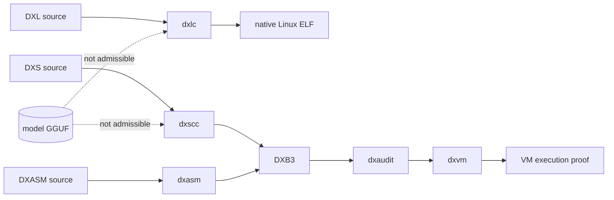

# Architecture

Pocket Rocket 0.4.2 is a deterministic inference substrate around one pinned local model transport. The model proposes text; deterministic software controls routing, arithmetic, storage, authorization, budgets, and audit commitments.

```text
request
  |
  v
exact/HDC routing -----> 1,024-cell committed capability fabric
  |                                  |
  |                                  v
  |                         bounded recursive quorum
  |                         depth + node + call ledger
  |                                  |
  v                                  v
ternary decision plane <------ proposal text from pinned DS4
  |
  +--> fail-closed envelope/cache/history ----> governance receipt
  |
  +--> NPRQ / Flat32 / Pocket Pack ----------> authenticated storage

native numeric plane:
  ternary_core -> TCAM / sparse reference / exact diagonal SSM
  binary32 integer oracle -> optional checked hardware candidates
  hamming_router -> exact 1,024-bit bounded linear scan
```

## Layers

- `agent_fabric.py` (Python): exact 1,024-bit SimHash routing, real bounded recursive traversal, exact consensus, node/call/depth trace certificates.
- `execution_plan.py` (Python): canonical topology record. It is descriptive; execution independently enforces budgets.
- `attest.py` (Python): verifies a source decision/run certificate and emits a portable canonical governance receipt.
- `envelope.py` / `lumus_arh.py` / `lbit_runtime.py` (Python): deterministic control-plane identity, fail-closed transitions, local proposal boundary, omission/coupling contracts. The oracle/coupling vocabulary has no quantum semantics.
- `nprq.py`, `pocket_pack.py`, `flat_dictionary.py`, `model_pages.py` (Python): bounded authenticated storage and progressive reconstruction.
- `nprq_verify.py` (Python): independently recomputes stage SSE when the original source tensor is supplied. Metadata alone is never called a proof of SSE.
- `ternary_ssm.py` (Python): real NPZ checkpoint comparator for the deliberately narrow diagonal SSM contract; not a Mamba compatibility claim.
- `native/ternary_core.c`: bounded exact ternary sign-plane dot products and exact triadic arithmetic.
- `native/ternary_tcam.c`: exact associative comparison with O(1) work per fixed 256-trit entry and an O(n) bounded software scan; AVX2 is explicit, never auto-dispatched.
- `native/ternary_ssm.c`: exact-int32 diagonal recurrence; binary32 is used only at the output projection boundary.
- `native/binary32.c`: integer IEEE-754 binary32 oracle plus checked hardware/x87 candidates and an explicit exact/hardware runtime mode.
- `native/hamming_router.c`: exact 1,024-bit Hamming scan for separating Python orchestration latency from the native algorithmic cost.

The native C APIs are strict C11, bounded, and exercised by normal, ASan, and UBSan targets. No model weights are distributed.

## Independent Aegis language toolchain



The model and storage nodes are not inputs to the language toolchain. For a
complete versioned contract and executed tests, see
[docs/AEGIS_INTEGRATION.md](docs/AEGIS_INTEGRATION.md).
