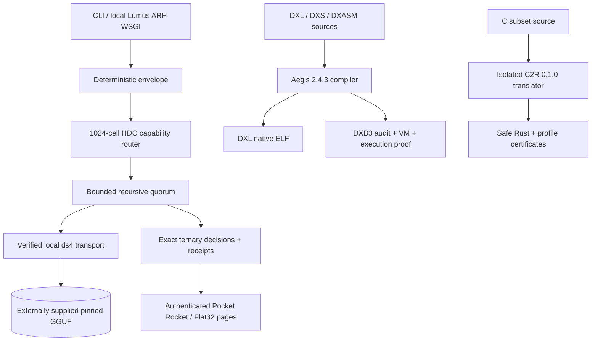

# Pocket Rocket 0.4.2 — exact deterministic inference substrate

     

> **Test status:** 169 Python, 6 GTK source-contract, Pocket Rocket native GCC/ASan/UBSan, Aegis 2.4.3 standard suite, and Aegis-C2R 37/37 passed locally. The stronger Aegis source-vs-shipped compiler byte-identity gate did **not** pass on this host. See [qualification report](docs/RELEASE_TEST_REPORT.md).

## Architecture at a glance



The Aegis source-execution branch does **not** feed model weights, storage or
the local inference path. It is a separate versioned language toolchain.

**Documentation:** [System architecture](ARCHITECTURE.md) · [Aegis integration](docs/AEGIS_INTEGRATION.md) · [Aegis/storage boundary](docs/AEGIS_POCKET_ROCKET_BOUNDARY.md) · [Lumus ARH architecture](docs/LUMUS_ARH_ARCHITECTURE.md) · [Release test results](docs/RELEASE_TEST_REPORT.md) · [Native benchmarks](docs/MEASURED_NATIVE_BENCHMARKS.md) · [Security](SECURITY.md).


Pocket Rocket is a local deterministic control/storage/numeric substrate around one pinned model proposal source. It combines exact ternary decision arithmetic, checked IEEE-754 binary32 reference arithmetic, authenticated model-page formats, a committed 1,024-cell HDC capability fabric, genuinely traversed and independently budgeted recursive quorums, portable governance receipts, exact software TCAM, and a constant-state exact diagonal SSM reference. The GGUF and DS4 source are not redistributed.

It is **not** a new trained language model, a claim that sparsity automatically speeds up dense CPUs, a claim that software TCAM is O(1) over a table, a Mamba/BitMamba implementation, a quantum system, or proof that model proposals are correct. The native sparse and AVX2 paths are explicit opt-ins and their release measurements are reported even when they lose.

## Five-minute quickstart

```bash
python -m pip install -e .
neuro-inverse init-store
neuro-inverse route "audit a bounded local inference path"
make -C native test
python -m unittest discover -s tests -v
```

The pinned model path remains separate and weight-free in the repository; see `scripts/download_deepseek_v4.py`, `scripts/install_ds4.py`, and `docs/MEASURED_NATIVE_BENCHMARKS.md`.


### Run the included Aegis toolchain

```bash
make aegis-test
PYTHONPATH=src python -m neuro_inverse aegis-doctor
PYTHONPATH=src python -m neuro_inverse aegis-run toolchains/aegis-language-suite-2.4.3/examples/loops/dxs/counter.dxs
make c2r-test
```

The DXS command compiles to audited DXB3, executes the **real** VM, and emits
a proof digest. DXL instead emits a static Linux executable. These paths are
not mock implementations and are not used to interpret model storage.

## Explicit non-claims

- No quantum computation, quantum speedup, or quantum semantics.
- No parameter-count inference from GGUF byte size and no redistribution of the GGUF.
- No model-quality or correctness claim follows from deterministic routing, consensus, or certificates.
- No general sparse-dot speedup on x86-64; the dense path remains the default.
- Software TCAM is O(1) per fixed-width entry and O(n) across n entries.
- The exact diagonal SSM kernel is not Mamba compatibility and its microbenchmark tokens/s is not language-model generation speed.
- No external pretrained-checkpoint divergence number is reported unless a compatible checkpoint is actually supplied and measured.

## What is implemented

- A 1,024-cell hyperdimensional capability fabric: eight roles × sixteen
  domains × eight facets. SHAKE-256 token hypervectors, integer majority
  bundling, exact 1,024-bit Hamming distance, stable ties, and a committed
  `fabric_root` make routing deterministic and reproducible without floats.
- Bounded recursive model execution with 2–5-member quorums, a maximum depth
  of six, a maximum of 64 activated nodes, fail-closed budgets, and no alternate
  model backend. Response agreement is classified directly as
  `reject / abstain / accept` using exact rational thresholds; it is an
  agreement signal, not a correctness proof.
- Content-addressed plans and run certificates binding the fabric, request,
  limits, selected cells, route distances, response hashes, pair distances,
  ternary status, and returned answer. `verify_run_certificate` detects answer
  or transcript changes without rerunning inference.
- A runtime-surface release gate that rejects mock/fake/stub imports and
  incomplete production raises, and requires every public release API to have an
  export, CLI consumer, or direct test. Agent-fabric tests use no test double.
- Exact semantic `reject / abstain / accept` statuses, exact triadic scoring,
  tie-aware typed Choice, exact ordered Score distributions, and deterministic
  certificates. No host float is used by this decision plane.
- Direct ternary sign-plane vectors and popcount dot products in Python and a
  bounded strict-C11 fast path. Zero is a real trit.
- A Merkle-rooted model page manifest, deterministic static materialization,
  demand materialization, bounded authenticated range reads, and a shared root
  across both modes. Each page runs a lossless codec competition; byte shuffle
  exposes same-byte lanes before DEFLATE without changing tensor values.
- Corrected 128 GiB whole-model bounds so the pinned 86,720,111,488-byte GGUF
  fits the container contract while page and range limits remain small.

- Strict downloader for the pinned `antirez/deepseek-v4-gguf` GGUF; the
  immutable revision, exact byte size, GGUF header, and SHA-256 are checked.
- Exact dense-to-expert SwiGLU identity:
  `FFN(x) = sum(expert_e(x))` when all experts are active.
- NPRQ: independently readable legacy ternary and v2 signed-quaternary residual
  stages, 2 bits/value/stage plus float16 block scales, with exact payload/hash
  validation and a stored-scale SSE gate that makes reconstruction error
  monotonically non-increasing.
- One shared 256-bit deterministic projection, per-layer expert centroids,
  exact Hamming distance, and stable expert-ID tie breaking.
- Verified Golden-Hamming indexing: a deterministic 512-bucket SplitMix64
  candidate index, full four-word coordinate checks, and an exact Hamming
  ranking fallback. It preserves the linear router's result; it is not an
  approximate-nearest-neighbor claim or an accuracy certificate.
- Native low-C DwarfStar model engine with SSD-streamed routed experts; Python
  is retained for packaging, evidence, and the exact reference-math oracle.
- Runnable one-stage base ZIP plus optional residual overlay packer.
- Adaptive page packing that measures raw NPRQ, one shared-dictionary Flat32,
  and Pocket Pack for each page, then commits the smallest verified byte total
  with a deterministic tie order (`raw`, `pocket`, `flat32`).
- A full, checksum-pinned Aegis 2.4.3 compiler/VM suite with direct
  source compilation, audited DXB3 execution and proof generation; an
  isolated Aegis-C2R 0.1.0 translator is also packaged. It verifies Pocket Rocket or hashes Flat32 as storage only and
  never treats model weights as source. See
  `docs/AEGIS_POCKET_ROCKET_BOUNDARY.md`.
- An exact integer/`Fraction` binary32 add/multiply/divide/square-root
  reference with canonical NaN, signed-zero, gradual-subnormal, overflow, and
  ties-to-even contracts; hardware candidates are accepted only after bitwise
  agreement. Fixed-order and explicitly distinct pairwise dot products reuse
  only the reference multiply/add. See
  `docs/BINARY32_NUMERIC_CONTRACT.md`.
- Native DwarfStar/ds4 is the only production execution boundary for the GGUF.

The exact ternary decision plane is production code; it is not a claim that
the upstream DeepSeek tensor graph is already ternary. The pinned ds4 chat path
retains its upstream numerical formats. See `docs/TERNARY_DECISION_RUNTIME.md`
for the explicit boundary and `docs/MODEL_PAGE_STORE.md` for the page format.

The full transformer hot path is therefore compiled low C in ds4. The Python
layer is not pretending to be the model engine: it verifies downloads, builds
the pinned runtime, hosts the optional loopback Lumus ARH, and acts as the exact
numeric oracle. The included dependency-free C11 core independently validates
NPRQ, Hamming, envelopes, Flat32, and Pocket Pack. Handwritten assembly is only
admissible as a hardware candidate after bitwise conformance; it is not used to
change the model format.

The v2 NPRQ reconstruction equation is

```text
W_hat_m = sum(i=0..m) scale_i * q_i,    q_i in {-3,-1,+1,+3}
```

with a stored-float16 SSE gate. On the seeded synthetic fixture, measured
relative weight error for stages 1–4 is `0.341747`, `0.138509`, `0.086787`,
and `0.062876`; the corresponding stage bytes are `4224`, `8448`, `12672`,
and `16896`. These are NPRQ-shaped proof measurements, not DeepSeek quality
measurements.

Golden-Hamming uses the fixed 64-bit constant
`K = 0x9E3779B97F4A7C15` and exact distance

```text
d_H(a,b) = popcount(int_le(a) XOR int_le(b)),   |a|=|b|=256 bits
```

The 512-bucket index supplies collision-checked exact-coordinate candidates;
the final route still scans eligible records for exact Hamming distance,
compatibility filtering, and expert-ID ties. It preserves the linear route and
does not yet constitute a measured speedup.

## Build on the target Linux/CachyOS machine

Budget at least 90 GB for the verified 86,720,111,488-byte model plus runtime
files. The product profile is 16 GiB system RAM, 8,192-token context, up to
2,048 output tokens, and a 1 GiB routed cache. Qualification begins at the
512/16 smoke profile and proceeds through 2,048/128 and 4,096/512 before the
8,192/2,048 product gate. Every frontier is measured, never assumed.

```bash
./scripts/bootstrap.sh
source .venv/bin/activate
./scripts/build_full_experiment.sh
```

The script downloads only the official repositories hard-coded in the source.
It never uploads, edits, or re-publishes Hugging Face content. The large model
files stay under ignored `models/`, `var/`, and `releases/` directories.

Run the compressed model:

```bash
python scripts/download_deepseek_v4.py
python scripts/install_ds4.py
python scripts/pocket_rocket_estimate.py
python scripts/run_16gb_gate.py
```

After the gate passes, use the same guarded native transport directly or
through the restored pre-React loopback API:

```bash
neuro-inverse chat "Explain the Pocket Rocket architecture"
neuro-inverse serve --port 8000
curl -sS http://127.0.0.1:8000/ask \
  -H 'content-type: application/json' \
  --data '{"question":"Hello"}'
```

Both commands use the pinned GGUF and ds4 revision, temperature zero, 1 GiB
expert cache, 8,192-token product context, a 2,048-token maximum response,
streaming-layer safety switch, and the shared 14.5 GiB process-tree RSS guard.
There is no second model backend.

The optional user-owned restart loop is documented in `docs/USER_DAEMON.md`.
It performs no installation or privileged operation and records a separate log
for every launch.

By default, Hamming chooses order but authenticated omitted-expert and
omitted-stage bounds control stopping. If a bound cannot be authenticated, the
Lbit planner requests the all-expert reference path. If that path cannot obey
the RAM envelope, it aborts; it never silently drops experts. The native gate
sets temperature zero, fixes command ordering, applies the streaming-layer
safety switch, and records hashes plus peak process-tree RSS. This narrows
same-host replay; it does not claim cross-device bit identity for upstream
kernels.

The 16 GiB gate generates real tokens only after full GGUF hashing and pinned
ds4 installation. A GGUF is never silently routed through another adapter.

## Exact decision and page commands

```bash
PYTHONPATH=src python -m neuro_inverse ternary-dot -- '-0++' '+0+-'
PYTHONPATH=src python -m neuro_inverse route-decide 'review this parser' --minimum-margin 2
PYTHONPATH=src python -m neuro_inverse score \
  --level low:1:0 --level medium:2:0 --level high:6:0 \
  --minimum-confidence 1:3 --model-root "$(printf '0%.0s' {1..64})" \
  --request-root "$(printf '1%.0s' {1..64})"

PYTHONPATH=src python -m neuro_inverse model-manifest MODEL.gguf MODEL.pages.json
PYTHONPATH=src python -m neuro_inverse model-analyze MODEL.pages.json MODEL.gguf
PYTHONPATH=src python -m neuro_inverse model-import \
  MODEL.pages.json MODEL.gguf MODEL_STORE --mode static
PYTHONPATH=src python -m neuro_inverse model-import \
  MODEL.pages.json MODEL.gguf MODEL_STORE --mode demand
```

Static and demand imports are checked against the same `model_root`. The
manifest requires one complete source read; after that, demand reads verify
only the pages they materialize.

## Recursive capability-fabric commands

Inspect the complete maximum execution envelope without loading a model:

```bash
PYTHONPATH=src python -m neuro_inverse agent-plan \
  "audit the authenticated page reader" --max-depth 2 --max-nodes 9 --quorum 3
```

Execute it through the pinned local model after the normal model/runtime setup:

```bash
PYTHONPATH=src python -m neuro_inverse agent-run \
  "audit the authenticated page reader" --max-depth 2 --max-nodes 9 \
  --quorum 3 --max-new-tokens 512
```

`agent-run` returns JSON containing the selected answer, direct ternary status,
transcript, and certificate. An `abstain` is not translated to false or true.
No arbitrary shell/file tools are exposed to model output, and the orchestrator
does not modify source code. See `docs/RECURSIVE_FABRIC_0_3.md` for the exact
algorithm, boundaries, threat model, and scientific status.

## Fast local proofs

```bash
make test
make proof
make benchmark
make agent-fabric-benchmark
make page-codec-benchmark
make surface-audit
make archive-check
```

The included synthetic proof currently shows all-expert dense reconstruction at
`3.826764896075474e-7` relative error and monotonic NPRQ error across four
stages. Hamming-only sparse output error at 1/2/4/8/16 experts is
`0.961184`, `0.927032`, `0.884230`, `0.740197`, and `3.826765e-7`. The curve
is why routing order and certified stopping remain separate. Real DeepSeek quality,
speed, VRAM, RAM, and SSD traffic must still be measured on the target PC.

The adaptive packer’s current NPRQ-shaped fixture measurements are:

| fixture | raw bytes | Flat32 + dictionary | raw / Flat32 | Pocket Pack | raw / Pocket |
| --- | ---: | ---: | ---: | ---: | ---: |
| random | 202,752 | 204,136 | 0.993220× | 190,823 | 1.062513× |
| structured | 202,752 | 9,096 | 22.290237× | 1,433 | 141.487788× |

These are measured synthetic storage fixtures, not full-DeepSeek compression or
quality results. For Flat32 with `B=32` bytes/block, `N` total blocks,
`R` registered blocks, `F=N-R`, `D≤256` dictionary entries, header `H`, and
tail `T`:

```text
bitmap = ceil(N/8)
stream = H + T + bitmap + R + 32F
dictionary-inclusive = stream + 32D
ratio = (32N) / stored_bytes
```

The dictionary is included in the Flat32 total; no unmeasured framing or
interpretation is hidden in that accounting.

DeepSeek model files remain upstream artifacts. This repository contains no
model weights and is MIT licensed only for its own code.

The CPU-only declarative-spec corrections and exact pass/pending ledger are in
`docs/CPU_ONLY_V1_SPEC_REVIEW.md` and `docs/V1_ACCEPTANCE_MATRIX.md`. The native
GTK4 coding workspace is in `ui/`; its chat/reset, edit/save, Git, test, task,
and documentation actions are local-only. `docs/IMAGE_RUNTIME_V1.md` records a
permissive CPU image-runtime candidate, but no image model or generated-image
qualification is claimed in this checkpoint.

The deterministic proposal/cache/history layer recovered from the pre-React
Lumus architecture is specified in `docs/LUMUS_ARH_ARCHITECTURE.md`.
The lossless page packer and DeepSeek V4 Flash target are specified in
`docs/POCKET_ROCKET.md`.
Recovered DPU/Rendr notes and their non-claims are recorded separately in
`docs/RECOVERED_ACCELERATOR_FACTS.md`: DPU render reuse used exact signature
equality, not Hamming; T3DPU/T3V are virtual deterministic accelerators; DXT4
T39 uses checked int64 host execution. The inspected Renderer/DPU 2.6 source
uses ordinary C `float`, not a cross-hardware deterministic neural format.
